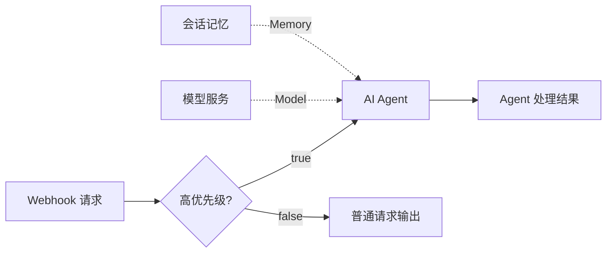

# Urtoris

> **来源与贡献：** 本分支由 [@breadget](https://github.com/breadget) 导入和维护，包含协作或第三方成果；历史作者与许可见 [ATTRIBUTION.md](ATTRIBUTION.md)。新的提交记录表示导入与维护，不代表全部代码为个人独立原创。

### 用自然语言搭建 AI 工作流，在画布上编辑，让执行过程可追踪。

Urtoris 是一个可自部署的 **AI 工作流编排与执行工作台**：用辅助 Agent 生成或修改流程，在可视化画布上调整节点与分支，保存版本，并通过 n8n 对接实际执行。

项目围绕两个入口展开：**创建端负责搭建和发布，使用端负责对话、调用与查看结果。**

**自然语言编排 · 节点画布 · 多模型接入 · 版本回滚 · n8n JSON 导出 · 运行追踪**

[核心特点](#核心特点) · [一个例子](#一个例子客服请求分流) · [快速开始](#快速开始) · [当前进度](#当前进度与边界) · [分支导航](#分支导航) · [项目文档](#项目文档)

> 当前为持续开发中的原型。画布编辑、AI 辅助编排、编译预览和版本快照已实现；n8n 自动导入与部署仍未开放，真实执行需要单独配置运行绑定。

## 核心特点

| 特点 | 你可以做什么 |
| --- | --- |
| **说清需求，再编辑流程** | 辅助 Agent 可以新建工作流，也可以修改当前画布。先查看提案，再确认应用；编辑提案应用后支持一步撤销。 |
| **把 Agent 的组成画出来** | 拖拽节点、连接端口，分别配置 Model、Memory 和多个 Tool；Condition 支持 true / false 分支，并检查连接类型、端口容量和循环。 |
| **自由选择模型服务** | 接入通义千问、OpenAI、DeepSeek、Kimi、智谱 GLM、Claude、Gemini、Ollama 或自定义 OpenAI 兼容服务；模型名支持手填。 |
| **改草稿，保留已发布版本** | 草稿与发布快照独立保存，支持版本列表和回滚；保存冲突会明确提示，避免覆盖其他修改。 |
| **把画布编译成 n8n JSON** | 支持编译预览、下载产物和发布快照；同一输入生成一致产物，凭据通过引用接入，不写入导出的工作流。 |
| **追踪真正发生的执行** | 对已接入的运行展示结果、时间线和错误原因；收到真实节点事件时更新节点与分支状态，支持增量读取。 |
| **连接外部服务与机器人接口** | 通过 HTTP Request、HTTP Tool 和 Robot Action 节点组织调用；Robot Action 编译为 HTTP 指令，设备与控制服务由使用者自行接入。 |

### 两个 Agent，各司其职

| | Studio 辅助 Agent | 工作流内的 Agent |
| --- | --- | --- |
| 职责 | 根据需求生成或修改节点、配置与连线 | 在执行时理解输入、调用模型与工具 |
| 配置位置 | Studio 的辅助 Agent 面板 | 画布上的 AI Agent 与 Model 节点 |
| 生效方式 | 确认提案后应用到画布，再保存 | 按配置好的执行路径运行 |

辅助编排使用的模型和 Key，与工作流运行时使用的模型和凭据分别配置。

## 一个例子：客服请求分流

可以向 Studio 的辅助 Agent 描述：

> 创建一个客服分流工作流：接收 Webhook 请求，按 urgency 是否为 high 分流。高优先级交给 AI Agent，连接通义千问模型和会话记忆，再输出处理结果；其余请求走另一个输出节点。

对应的流程结构示意：



生成后仍可在画布中调整分支、替换模型、编辑提示词，再编译检查并导出 n8n JSON。实际调用外部服务前，需要配置自己的端点与凭据。

## 分支导航

| 分支 | 内容 |
| --- | --- |
| [`main`](https://github.com/breadget/jiaojiao-luo/tree/main) | Urtoris 主分支与项目总览 |
| [`codex/agent-behavior-constraints`](https://github.com/breadget/jiaojiao-luo/tree/codex/agent-behavior-constraints) | Agent 行为约束相关开发 |
| [`codex/graph-runtime-canary`](https://github.com/breadget/jiaojiao-luo/tree/codex/graph-runtime-canary) | Graph 运行与 canary 验证 |
| [`codex/local-sqlite`](https://github.com/breadget/jiaojiao-luo/tree/codex/local-sqlite) | 本地 SQLite 相关开发 |
| [`codex/publish-ai-workspace`](https://github.com/breadget/jiaojiao-luo/tree/codex/publish-ai-workspace) | AI 工作台发布相关开发 |
| [`codex/python-agent-deploy`](https://github.com/breadget/jiaojiao-luo/tree/codex/python-agent-deploy) | Python Agent 与部署相关开发 |
| [`codex/toolchain-w4-ssrf-fix`](https://github.com/breadget/jiaojiao-luo/tree/codex/toolchain-w4-ssrf-fix) | 工具链 W4 SSRF 修复 |
| [`codex/urtoris-ios`](https://github.com/breadget/jiaojiao-luo/tree/codex/urtoris-ios) | Urtoris iOS 客户端相关开发 |
| [`openbot`](https://github.com/breadget/jiaojiao-luo/tree/openbot) | OpenBot 上游项目快照，保留其 MIT 许可 |
| [`toolchain`](https://github.com/breadget/jiaojiao-luo/tree/toolchain) | 工作流工具链 |

## 快速开始

需要 **Node.js ≥ 22.13.0** 和 npm。本地使用 D1 模拟数据库；体验画布与编排不需要先部署 n8n。

### 1. 下载并安装

```bash
git clone https://github.com/breadget/jiaojiao-luo.git
cd jiaojiao-luo
npm ci
```

### 2. 初始化全新的本地数据库

在项目根目录按顺序应用迁移。**以下命令只对全新的本地数据库执行一次**；已有数据库应按实际迁移状态处理。

```bash
for migration in drizzle/[0-9]*.sql; do
  npx wrangler d1 execute DB --local --config wrangler.local.jsonc --file "$migration"
done
```

### 3. 启动

```bash
npm run dev
```

打开 [http://localhost:3000](http://localhost:3000)：

- **创建工作流端**：进入 `/studio`，拖拽编排，或打开辅助 Agent 生成流程。
- **使用工作流端**：从首页进入，选择已发布工作流，与 Agent 对话并查看运行结果。

本机访问默认支持管理操作，无需额外粘贴管理员令牌。辅助 Agent 调用在线模型时，需要填入自己的模型 API Key；在运行站点的同一台机器上使用免 Key 的 Ollama 服务时可留空。

### 建议先体验这一条路径

1. 打开 `/studio`，在辅助 Agent 面板选择模型服务并配置 Key。
2. 选择「新建工作流」，输入上面的分流需求，生成并检查提案。
3. 确认创建后，调整画布、保存草稿，再打开「编译预览」。
4. 下载 n8n JSON，或发布快照并查看版本记录。

**发布 Graph 快照不会自动导入 n8n，也不会同步到旧版步骤发布通道。** 若要在使用端运行新画布，需要继续完成 n8n 接入与绑定，详见[发布说明](docs/WORKFLOW_GRAPH_RELEASE.md)。

### 检查与构建

```bash
npm run lint
npm test
npm run build
```

## 接入 n8n 与外部调用

通过服务器本地的 `.dev.vars` 配置运行环境。该文件已被忽略，不应提交到仓库。

| 环境变量 | 用途 |
| --- | --- |
| `URTORIS_ADMIN_TOKEN` | 公网保存草稿、编译、发布、回滚等管理操作；与 API 令牌分别配置 |
| `URTORIS_API_TOKEN` | 外部程序调用执行接口时使用的 Bearer 令牌 |
| `N8N_BASE_URL` | n8n 服务根地址 |
| `N8N_WEBHOOK_TOKEN` | 站点调用 n8n Webhook 时使用的令牌 |
| `URTORIS_INTERNAL_TOKEN` | n8n 向站点回传执行事件时使用的令牌 |

主要接口：

| 接口 | 用途 |
| --- | --- |
| `POST /api/workflows/agent` | 生成新建或编辑画布的提案 |
| `GET` / `PUT` `/api/workflows/:id/graph` | 读取或保存 Graph 草稿 |
| `POST /api/workflows/:id/graph/preview` | 编译预览 |
| `POST /api/workflows/:id/graph/publish` | 发布不可变版本快照 |
| `POST /api/agent/chat` | 使用端 Agent 对话 |
| `POST /api/v1/run` | 从外部程序调用已发布工作流 |
| `GET /api/runs/:requestId/telemetry` | 增量读取节点遥测 |

权限、请求格式和返回约定见[运行协议](docs/PROTOCOL-v1.md)、[运维说明](docs/OPERATIONS.md)及[发布说明](docs/WORKFLOW_GRAPH_RELEASE.md)。ECS、Nginx、systemd 与 n8n 配置参考 [deploy/](deploy/README.md)。

## 当前进度与边界

| 状态 | 范围 |
| --- | --- |
| **已实现** | 可视化编辑、AI 新建与改图、多模型配置、草稿持久化、编译预览、JSON 下载、不可变发布快照与回滚 |
| **按接入情况可用** | 既有发布绑定的 n8n 执行、执行结果与节点事件展示；需要配置服务、凭据和事件来源 |
| **尚未开放或完成** | 自动导入/激活 n8n、Graph 与旧步骤发布通道同步、完整节点输入输出快照、SSE 事件推送、完整用户账号与团队权限系统 |

- **可编排节点与可编译节点有范围区别。** 当前 Adapter 支持 Trigger、Condition、AI Agent、Model、Memory、HTTP Tool、HTTP Request、Robot Action、Output；Database、Transform、Subworkflow 等类型暂不支持编译，遇到时会明确报错。
- **本地 Preview 是预演。** 合成状态会标注为演示；真实运行没有节点事件时，不会展示虚构的节点执行状态。导出的 JSON 也尚未自动包含完整事件上报链路。
- **Key 的保存位置明确区分。** 使用端的模型配置保存在浏览器 `localStorage`，辅助 Agent 配置保存在 `sessionStorage`；服务端按请求使用 Key，不写入 Graph、D1 或运行记录。
- **模型兼容与真实验证分开。** 已实现多种协议适配，各服务的真实调用仍取决于模型权限、端点和凭据，部分端到端验证待补充。

详细实施记录与待办见[未完成项目清单](docs/UNFINISHED_TASKS.md)。

## 技术栈

| 层次 | 技术 |
| --- | --- |
| 应用与前端 | React 19、TypeScript、Vinext / Vite、Tailwind CSS、shadcn |
| 可视化画布 | React Flow（`@xyflow/react`） |
| 数据与运行时 | Cloudflare D1、Drizzle ORM、Workers / Wrangler |
| 工作流对接 | n8n Adapter、Webhook、`urtoris.v1` 协议 |
| 模型调用 | OpenAI 兼容协议、Anthropic Messages、Gemini generateContent |

## 项目文档

| 文档 | 内容 |
| --- | --- |
| [多模型接入](docs/LLM_PROVIDERS.md) | 模型服务、BYO Key、直连与 n8n 的配置区别 |
| [工作流发布](docs/WORKFLOW_GRAPH_RELEASE.md) | 草稿、版本、编译范围、回滚与接入限制 |
| [Graph Schema](docs/WORKFLOW_SCHEMA.md) | 节点、端口、连接与校验规则 |
| [运行协议](docs/PROTOCOL-v1.md) | 请求、响应、执行关联与错误语义 |
| [架构分析](docs/CURRENT_ARCHITECTURE.md) | 架构演进与实现决策 |
| [部署与运维](deploy/README.md) | ECS 部署材料与 n8n 配置入口 |
| [开发进度](docs/UNFINISHED_TASKS.md) | 已完成能力和剩余工作 |
